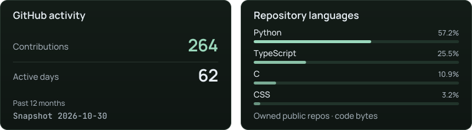

<picture>
  <source media="(max-width: 480px)" srcset="./assets/header-dark-mobile.svg?v=b07661e122" />
  <source media="(max-width: 1100px)" srcset="./assets/header-dark-compact.svg?v=dfd34918ab" />
  
</picture>

  
  
  
  
  

  Hey, I'm Kanav, a <strong>Computer Science undergrad at IIIT Bangalore ('28)</strong>. 
  I build software and explore <strong>AI/ML, systems and backend engineering</strong>, 
  usually by asking what happens under the hood.

  Away from the keyboard: cricket, gym, travelling. 
  Usually followed by “just one more episode.”

<h3 align="center">
  <picture>
    <source media="(max-width: 480px) and (prefers-color-scheme: dark)" srcset="./assets/sections/selected-work-mobile.svg?v=c258dbda3d" />
    <source media="(max-width: 480px) and (prefers-color-scheme: light)" srcset="./assets/sections/selected-work-light-mobile.svg?v=e45562395c" />
    <source media="(max-width: 1100px) and (prefers-color-scheme: dark)" srcset="./assets/sections/selected-work-compact.svg?v=b8bd2c4b67" />
    <source media="(max-width: 1100px) and (prefers-color-scheme: light)" srcset="./assets/sections/selected-work-light-compact.svg?v=0726af1756" />
    <source media="(prefers-color-scheme: dark)" srcset="./assets/sections/selected-work.svg?v=69da293a49" />
    <source media="(prefers-color-scheme: light)" srcset="./assets/sections/selected-work-light.svg?v=7bbb27b777" />
    
  </picture>
</h3>

  <a href="https://github.com/COolAlien35/PitchPerfect">
    <picture>
      <source media="(max-width: 480px)" srcset="./assets/projects/pitchperfect-mobile.svg?v=9e8348b8ed" />
      <source media="(max-width: 1100px)" srcset="./assets/projects/pitchperfect-compact.svg?v=e790d4190a" />
      
    </picture>
  </a>

<table align="left">
  <tr><td>
    <a href="https://github.com/Jdsb06/SmartCampus"><picture><source media="(max-width: 360px)" srcset="./assets/projects/smartcampus-narrow.svg?v=370878899f" /><source media="(max-width: 480px)" srcset="./assets/projects/smartcampus-mobile.svg?v=c80feb467a" /><source media="(max-width: 1100px)" srcset="./assets/projects/smartcampus-compact.svg?v=33c7ad6da7" /></picture></a> 
    <a href="https://github.com/Jdsb06/SmartCampus"><picture><source media="(max-width: 360px)" srcset="./assets/projects/source-narrow.svg?v=067ce9c828" /><source media="(max-width: 480px)" srcset="./assets/projects/source-mobile.svg?v=9845f75bca" /><source media="(max-width: 1100px)" srcset="./assets/projects/source-compact.svg?v=2c843e5179" /></picture></a>
  </td></tr>
</table>

<table align="right">
  <tr><td>
    <a href="https://github.com/DayalGupta03/Sign_Bridge1"><picture><source media="(max-width: 360px)" srcset="./assets/projects/signbridge-narrow.svg?v=b0d4ad7a52" /><source media="(max-width: 480px)" srcset="./assets/projects/signbridge-mobile.svg?v=281ca4ba8a" /><source media="(max-width: 1100px)" srcset="./assets/projects/signbridge-compact.svg?v=a1861c83e7" /></picture></a> 
    <a href="https://github.com/DayalGupta03/Sign_Bridge1"><picture><source media="(max-width: 360px)" srcset="./assets/projects/source-half-narrow.svg?v=a66db185a0" /><source media="(max-width: 480px)" srcset="./assets/projects/source-half-mobile.svg?v=48cdb18504" /><source media="(max-width: 1100px)" srcset="./assets/projects/source-half-compact.svg?v=1896295b2a" /></picture></a><a href="https://sign-bridge1.vercel.app"><picture><source media="(max-width: 360px)" srcset="./assets/projects/demo-half-narrow.svg?v=00768719cc" /><source media="(max-width: 480px)" srcset="./assets/projects/demo-half-mobile.svg?v=0d0b110a89" /><source media="(max-width: 1100px)" srcset="./assets/projects/demo-half-compact.svg?v=95ddf5a6e2" /></picture></a>
  </td></tr>
</table>

 

<table align="left">
  <tr><td>
    <a href="https://github.com/KINGKK-007/Mini-Swiggy"><picture><source media="(max-width: 360px)" srcset="./assets/projects/mini-swiggy-narrow.svg?v=dd422c78f6" /><source media="(max-width: 480px)" srcset="./assets/projects/mini-swiggy-mobile.svg?v=4f1fe0c51b" /><source media="(max-width: 1100px)" srcset="./assets/projects/mini-swiggy-compact.svg?v=73cbac5f1d" /></picture></a> 
    <a href="https://github.com/KINGKK-007/Mini-Swiggy"><picture><source media="(max-width: 360px)" srcset="./assets/projects/source-narrow.svg?v=067ce9c828" /><source media="(max-width: 480px)" srcset="./assets/projects/source-mobile.svg?v=9845f75bca" /><source media="(max-width: 1100px)" srcset="./assets/projects/source-compact.svg?v=2c843e5179" /></picture></a>
  </td></tr>
</table>

<table align="right">
  <tr><td>
    <a href="https://github.com/COolAlien35/AIC"><picture><source media="(max-width: 360px)" srcset="./assets/projects/aic-narrow.svg?v=1934af80f7" /><source media="(max-width: 480px)" srcset="./assets/projects/aic-mobile.svg?v=9cd647b913" /><source media="(max-width: 1100px)" srcset="./assets/projects/aic-compact.svg?v=ba4860d21f" /></picture></a> 
    <a href="https://github.com/COolAlien35/AIC"><picture><source media="(max-width: 360px)" srcset="./assets/projects/source-narrow.svg?v=067ce9c828" /><source media="(max-width: 480px)" srcset="./assets/projects/source-mobile.svg?v=9845f75bca" /><source media="(max-width: 1100px)" srcset="./assets/projects/source-compact.svg?v=2c843e5179" /></picture></a>
  </td></tr>
</table>

 

<h3 align="center">
  <picture>
    <source media="(max-width: 480px) and (prefers-color-scheme: dark)" srcset="./assets/sections/toolkit-mobile.svg?v=5f7adb50a1" />
    <source media="(max-width: 480px) and (prefers-color-scheme: light)" srcset="./assets/sections/toolkit-light-mobile.svg?v=29af6ff4e0" />
    <source media="(max-width: 1100px) and (prefers-color-scheme: dark)" srcset="./assets/sections/toolkit-compact.svg?v=7d654b5db6" />
    <source media="(max-width: 1100px) and (prefers-color-scheme: light)" srcset="./assets/sections/toolkit-light-compact.svg?v=cc37ca50d0" />
    <source media="(prefers-color-scheme: dark)" srcset="./assets/sections/toolkit.svg?v=853c19de5d" />
    <source media="(prefers-color-scheme: light)" srcset="./assets/sections/toolkit-light.svg?v=32c9544595" />
    
  </picture>
</h3>

  <picture>
    <source media="(max-width: 480px)" srcset="./assets/editorial/toolkit-mobile.svg?v=3eaebe0549" />
    <source media="(max-width: 1100px)" srcset="./assets/editorial/toolkit-compact.svg?v=8321cbb413" />
    
  </picture>

<h3 align="center">
  <picture>
    <source media="(max-width: 480px) and (prefers-color-scheme: dark)" srcset="./assets/sections/on-github-mobile.svg?v=10e7e7487a" />
    <source media="(max-width: 480px) and (prefers-color-scheme: light)" srcset="./assets/sections/on-github-light-mobile.svg?v=9ff928fc92" />
    <source media="(max-width: 1100px) and (prefers-color-scheme: dark)" srcset="./assets/sections/on-github-compact.svg?v=2663a53966" />
    <source media="(max-width: 1100px) and (prefers-color-scheme: light)" srcset="./assets/sections/on-github-light-compact.svg?v=0bab846f5d" />
    <source media="(prefers-color-scheme: dark)" srcset="./assets/sections/on-github.svg?v=7a19e5b234" />
    <source media="(prefers-color-scheme: light)" srcset="./assets/sections/on-github-light.svg?v=e2c49b8a5f" />
    
  </picture>
</h3>

  <picture>
    <source media="(max-width: 480px)" srcset="./assets/stats/overview-mobile.svg" />
    <source media="(max-width: 1100px)" srcset="./assets/stats/overview-compact.svg" />
    
  </picture>

  <a href="https://raw.githubusercontent.com/KINGKK-007/KINGKK-007/main/assets/stats/contributions.svg">
    <picture>
      <source media="(max-width: 480px)" srcset="./assets/stats/contributions-mobile.svg" />
      <source media="(max-width: 1100px)" srcset="./assets/stats/contributions-compact.svg" />
      
    </picture>
  </a>

<h3 align="center">
  <picture>
    <source media="(max-width: 480px) and (prefers-color-scheme: dark)" srcset="./assets/sections/along-the-way-mobile.svg?v=d1367cc1a0" />
    <source media="(max-width: 480px) and (prefers-color-scheme: light)" srcset="./assets/sections/along-the-way-light-mobile.svg?v=f04387fe3d" />
    <source media="(max-width: 1100px) and (prefers-color-scheme: dark)" srcset="./assets/sections/along-the-way-compact.svg?v=57e5af0511" />
    <source media="(max-width: 1100px) and (prefers-color-scheme: light)" srcset="./assets/sections/along-the-way-light-compact.svg?v=e5817fb0da" />
    <source media="(prefers-color-scheme: dark)" srcset="./assets/sections/along-the-way.svg?v=2042a64b82" />
    <source media="(prefers-color-scheme: light)" srcset="./assets/sections/along-the-way-light.svg?v=ca55cecf82" />
    
  </picture>
</h3>

  
  
  

  <picture>
    <source media="(max-width: 480px)" srcset="./assets/editorial/footer-mobile.svg?v=20b87c684f" />
    <source media="(max-width: 1100px)" srcset="./assets/editorial/footer-compact.svg?v=b20c57d013" />
    
  </picture>

